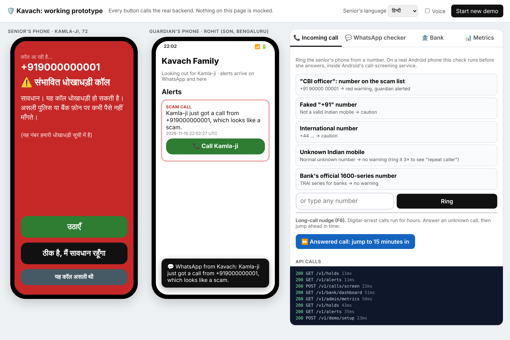
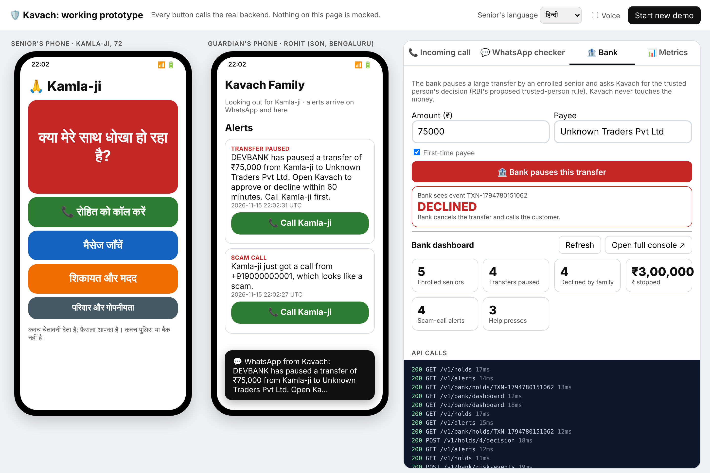

# Kavach (working name): scam protection for Indian seniors

The MVP from the PRD: an Android app for the senior, a guardian (family) mode,
a WhatsApp scam checker, and the v2 bank "trusted person" API. One backend.

```
kavach/
├── backend/            FastAPI + SQLAlchemy (SQLite in dev, Postgres in prod)
│   ├── app/risk/       risk engine: number rules, message/URL rules, LLM second opinion
│   ├── app/routers/    users+pairing+consent, protect (F2–F7), whatsapp, bank (F9/F11), admin metrics
│   ├── app/services/   auth (OTP), alerts fan-out, WhatsApp/push outbox, i18n (en/hi/mr), privacy notice
│   ├── data/           seed scam numbers (placeholders) + labelled message eval set
│   ├── scripts/        eval_checker.py
│   ├── app/static/     web prototype (/demo) and bank console (/bank)
│   └── tests/          27 tests
├── android/            Kotlin app, framework APIs only (no third-party libraries)
└── docs/               BANK_API.md, PLAY_POLICY.md, PRIVACY.md
```





## Live demo

**https://claude.ai/artifact/1PLFj74SmFpMuT4vb7R9hW** opens in any browser, phone included, with nothing to install.
It runs entirely in the browser (`docs/demo/index.html`): the same scam rules as the backend, ported to JavaScript
and checked against the Python engine by `tests/test_static_demo.py`. Demo data only.
Rebuild it after changing rules or text with `python backend/scripts/build_static_demo.py`.
The link is private to its owner until shared from its page on claude.ai. `docs/demo/` can also be served by GitHub Pages.

## Try the working prototype (2 minutes)

```bash
cd backend
pip install -r requirements.txt
KAVACH_ENV=dev uvicorn app.main:app --port 8000
```

Open **http://localhost:8000** and press **Start new demo**. You get three panels:

- **Senior's phone** (Kamla-ji, Hindi/Marathi/English): big help button, spoken checklist, message checker, report & recover, family permissions, pairing QR.
- **Guardian's phone** (Rohit): live alerts, one-tap call-back, approve/decline a paused bank transfer.
- **Control panel**:
  - ring her phone from a scam-list, spoofed, international or ordinary number
  - jump 15 minutes into a call (long-call nudge)
  - forward messages to the WhatsApp bot
  - have the bank pause a ₹75,000 transfer
  - watch the PRD's success metrics

Every button calls the real API, and the API calls are listed live at the bottom. The bank partner console is at **http://localhost:8000/bank** (key `dev-bank-key`).

Things to try for a pitch: ring the "CBI officer" number (red warning spoken in Hindi, and Rohit gets a WhatsApp alert); press the help button and answer "yes"; bank-pause a transfer and decline it on Rohit's phone (the bank console shows ₹ stopped).

**Android APK:** every push to `main` builds a debug APK in GitHub Actions. Open the repo's **Actions** tab, click the latest run, and download `kavach-debug-apk`. Install it on an Android 10+ phone, long-press the title on "Family & privacy" to set the server address to your laptop (e.g. `http://192.168.1.20:8000`, same Wi-Fi), and go.

**Hosting it:** `backend/Dockerfile` runs on any container host (Render, Railway, Fly.io, Cloud Run in Mumbai). Set `KAVACH_ENV=dev` for a public demo with fake data, `PUBLIC_URL` to its address, and `KAVACH_ENV=prod` plus the real keys from `.env.example` for real users.

## Feature status

| PRD | Feature | Backend | Android | Notes |
|---|---|---|---|---|
| F1 | Paired onboarding | ✅ OTP login, pairing code + QR, senior-controlled permissions, consent log | ✅ language → role → OTP → notice read aloud → call-screening role → QR; scanning the QR opens the app (`kavach://join`) | SMS provider not wired (dev returns OTP) |
| F2 | Pre-answer call warning | ✅ scam list, ≥3 user reports, number shape (+91 spoofing, international, 1600-series), repeat calls | ✅ `CallScreeningService` + full-screen warning + spoken in her language + offline scam-list cache | Never blocks a call; warns only |
| F3 | "Am I being scammed?" | ✅ alerts guardian on press; 5-question checklist; any "yes" → stop screen | ✅ big button, spoken questions, home-screen widget, works offline with family numbers | |
| F4 | Guardian alerts | ✅ WhatsApp template + push hook + in-app inbox, respects senior's permissions | ✅ guardian screen with one-tap call-back | Push (FCM) is a stub: needs a Firebase project |
| F5 | Scam checker | ✅ WhatsApp webhook (text, links, numbers, contacts, screenshots) + in-app; rules then Claude | ✅ paste/type, or "Share → Kavach" from any app | |
| F6 | Long unknown-call nudge | ✅ | ⚠️ spike: `READ_PHONE_STATE` + our own screened number | Needs Play policy confirmation, see docs/PLAY_POLICY.md |
| F7 | Report & recover | ✅ | ✅ 1930, cybercrime.gov.in, Chakshu, bank block line | Bank block numbers are placeholders |
| F8 | Weekly voice briefing | ❌ | ❌ | P2; not started |
| F9 | Bank risk events + trusted-person approval | ✅ idempotent events, 24h cooling-off before a guardian gains approval power, expiry, bank callback + polling | ✅ approve/decline in guardian screen | See docs/BANK_API.md |
| F10 | Human helper line | ❌ | ❌ | Needs telephony provider + responders |
| F11 | Bank dashboard | ✅ API + web console at `/bank` | n/a | |
| — | DPDP basics | ✅ itemised notice (en/hi/mr), consent records, export, delete | ✅ notice read aloud, delete my data | Legal review required |
| — | MVP metrics | ✅ `/v1/admin/metrics` | | activated pairs, weekly active, alert precision, false alarms, guardian response time |

## Run the backend

```bash
cd backend
pip install -r requirements.txt
python -m pytest -q                 # 27 tests
python scripts/eval_checker.py      # message checker accuracy on data/message_eval.jsonl (rules only)
KAVACH_ENV=dev uvicorn app.main:app --reload --port 8000
# open http://localhost:8000/docs for the interactive API
```

In dev mode the OTP comes back in the API response, and every WhatsApp/push message
is written to the `outbox` table instead of being sent, so you can test the whole flow
without Meta access. Bank API key in dev: `dev-bank-key`. Admin token: `dev-admin`.

To turn on the LLM second opinion set `ANTHROPIC_API_KEY`. The checker then uses
Claude (`claude-opus-5-5`, low effort, JSON-schema output) when the rules aren't
decisive, and for every screenshot. If the API fails or refuses, it falls back to the
rules verdict, so the bot never goes silent. Run `python scripts/eval_checker.py --llm`
to measure it before switching it on (this costs API credit).

## Build the Android app

Open `android/` in Android Studio (Ladybug or newer), let it sync, run on a phone
with Android 10+. In the app, long-press the title on the "Family & privacy" screen
to point it at your dev server (e.g. `http://10.0.2.2:8000` from the emulator; add
a network-security config if you use plain HTTP on a real device).

Test the call warning: add `+919000000001` (a seeded placeholder "scam" number)
to a second phone, or use the emulator's extended controls → Phone → call in.

**Verification status:** CI builds the APK on every push (see the Actions tab). It
has not yet been run on a real phone, so the call-screening role prompt, the full-screen
warning over the lock screen and text-to-speech voices all need a device test.

## Before launch (not code)

- Replace `data/scam_numbers_seed.json` placeholders with verified numbers. A wrong entry tells a senior a genuine caller is a scammer.
- Native-speaker review of every Hindi/Marathi string (`backend/app/services/i18n.py`, `android/.../ui/Strings.kt`).
- Grow `data/message_eval.jsonl` to 200+ real forwarded messages, and keep a held-out set. The current set is 35 messages the rules were tuned on, so the 97% accuracy figure is optimistic.
- WhatsApp: Meta Business verification, an approved utility template `kavach_guardian_alert` with one body parameter.
- SMS OTP provider + DLT registration, Firebase project for push, privacy/terms legal review, grievance officer contact.
- Alembic migrations before the first production deploy (dev uses `create_all`).
